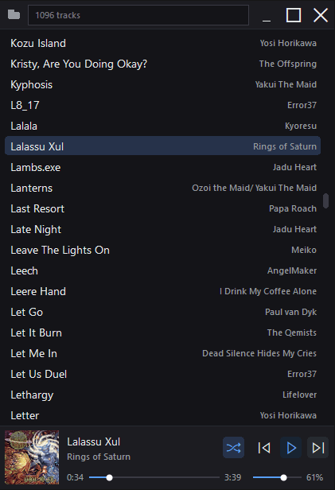

# Just Music

Крошечный музыкальный плеер для локальных файлов на Windows. Без излишков.

[English](README.md) · **Русский**



## Скачать

`just_music.exe` лежит в [последнем релизе](../../releases/latest). Без установщика и без рантайма.

## Сборка

```sh
cargo build --release
```

Результат: `target/release/just_music.exe` (~2,3 МБ).

Запуск `just_music.exe <папка>` сразу открывает папку (иначе — кнопка с папкой в заголовке).

## Настройки

Один файл: `%APPDATA%\JustMusic\settings.ini` — последняя папка, громкость, shuffle. Рядом лежит кэш просканированной библиотеки — `library.cache`.

## Удаление

Удалите `just_music.exe` и папку `%APPDATA%\JustMusic`.

## Автор

Навайбкожено с помощью DeepSeek v4.1 1017

## Лицензия

MIT — см. [LICENSE](LICENSE).
